<div align="center">

<a href="https://jordanngo205.github.io/toronto-tempo-analytics/">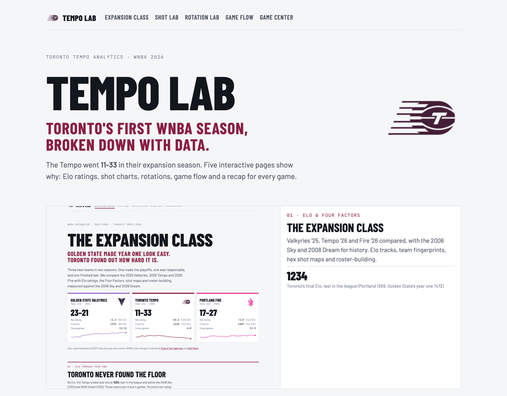</a>

# Tempo Lab · Toronto Tempo Analytics

**Toronto's first WNBA season, broken down with data. Five interactive pages and every chart built by hand.**

[](https://jordanngo205.github.io/toronto-tempo-analytics/)
[](https://www.python.org/)
[](https://py.sportsdataverse.org/)
[](docs/assets/kit.js)

[Expansion Class](https://jordanngo205.github.io/toronto-tempo-analytics/expansion-class/) ·
[Shot Lab](https://jordanngo205.github.io/toronto-tempo-analytics/shot-lab/) ·
[Rotation Lab](https://jordanngo205.github.io/toronto-tempo-analytics/rotation-lab/) ·
[Game Flow](https://jordanngo205.github.io/toronto-tempo-analytics/game-flow/) ·
[Game Center](https://jordanngo205.github.io/toronto-tempo-analytics/game-center/)

</div>

---

## The 2026 season in five numbers

| **11–33** | **1234** | **1.056 → 1.013** | **35–74** | **24** |
|:---:|:---:|:---:|:---:|:---:|
| Toronto's record in its expansion year | Final Elo, last in the WNBA and below the 2006 Sky and 2008 Dream | Expected vs actual points per shot. Good looks that didn't fall | Scoring runs of 8+ points, for vs against | Different starting lineups across 44 games |

---

## 01 · [The Expansion Class](https://jordanngo205.github.io/toronto-tempo-analytics/expansion-class/)

> Golden State made year one look easy. Toronto found out how hard it is.

This page compares the three newest franchises: Valkyries '25, Tempo '26 and Fire '26. The 2006 Sky and 2008 Dream are included for history. Elo ratings are built from every WNBA game since 2003, in the style of [Neil Paine](https://neilpaine.substack.com/t/basketball).

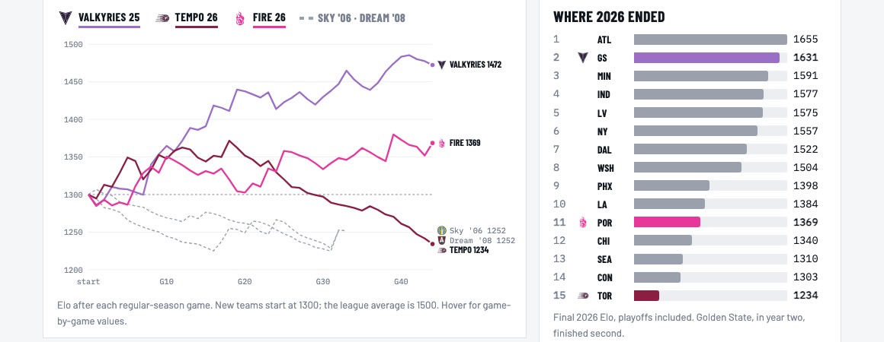

<table>
<tr>
<td width="50%">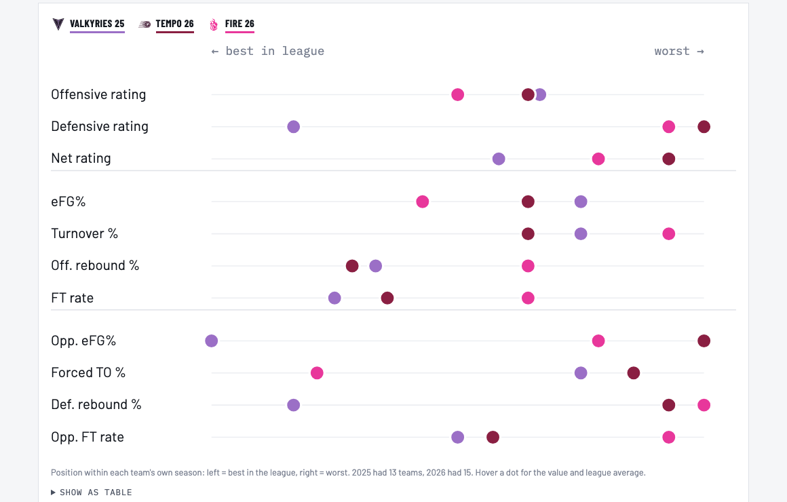<br><sub><b>Same offense, very different defense.</b> Toronto's offense ranked about the same as Golden State's in year one. Its defense ranked last.</sub></td>
<td width="50%">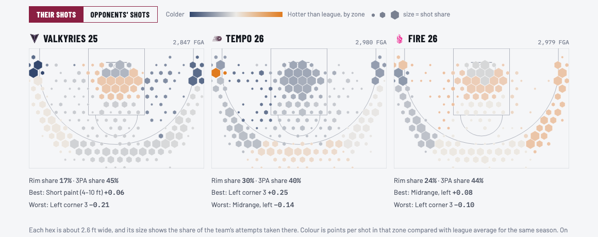<br><sub><b>Toronto lived at the rim and died there.</b> Hex size is shot share and colour is efficiency vs league. A toggle switches to opponents' shots.</sub></td>
</tr>
</table>

## 02 · [Shot Lab](https://jordanngo205.github.io/toronto-tempo-analytics/shot-lab/)

> Toronto got good looks. The shots didn't fall.

<table>
<tr>
<td width="50%">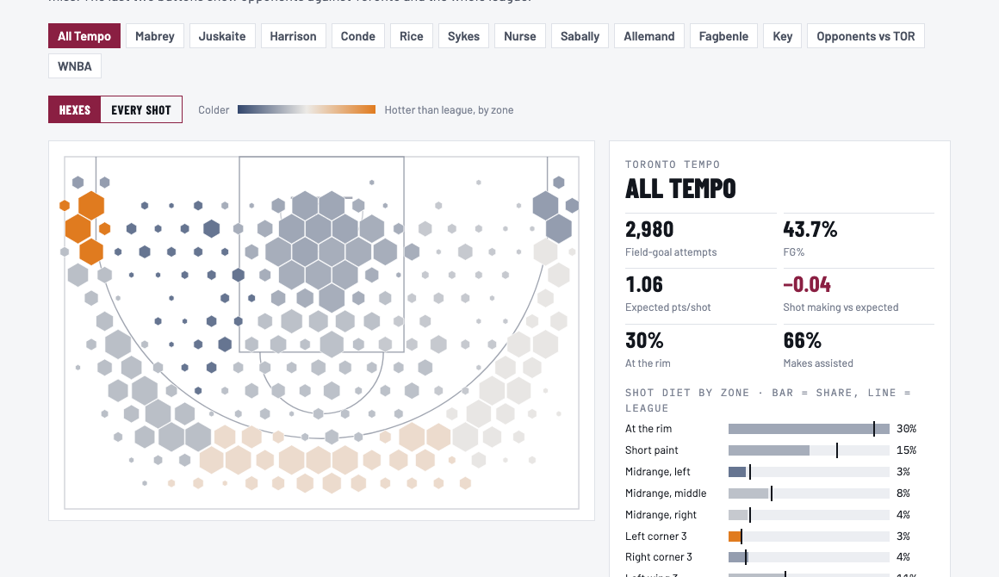<br><sub><b>Pick a shooter.</b> Hex maps or every make and miss for each Tempo player, opponents, or the whole league.</sub></td>
<td width="50%">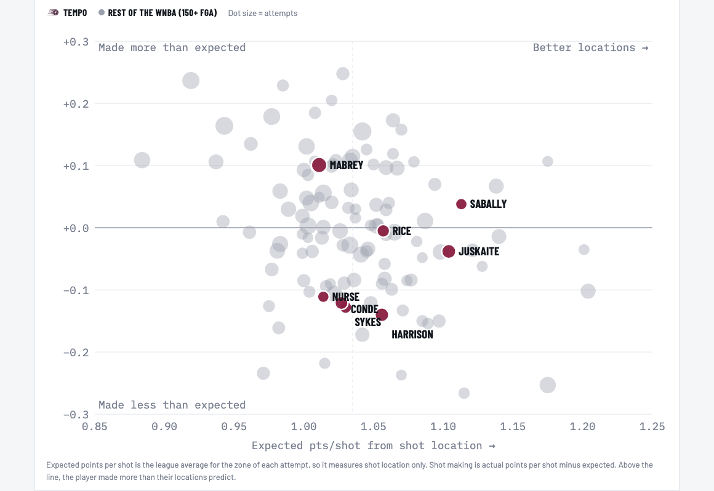<br><sub><b>Shot quality vs shot making</b> for every WNBA player with 150+ attempts. Most of Toronto's high-volume shooters fall below the line.</sub></td>
</tr>
</table>

## 03 · [Rotation Lab](https://jordanngo205.github.io/toronto-tempo-analytics/rotation-lab/)

> Who played, who played together, and how it went.

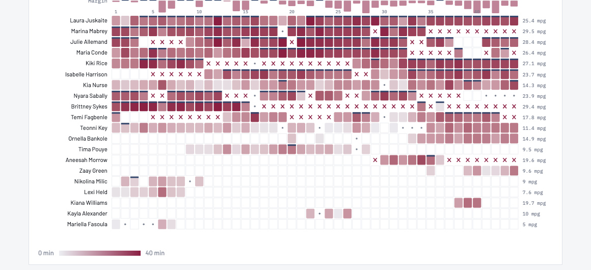
<sub>Every player in every game: minutes, starts, injuries and coach's decisions, with each final margin across the top.</sub>

<table>
<tr>
<td width="50%">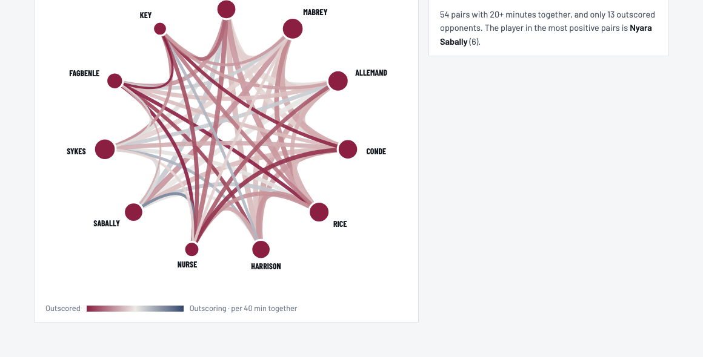<br><sub><b>Chemistry network.</b> Edge width is minutes together and colour is plus-minus per 40.</sub></td>
<td width="50%"><sub><b>Also on the page:</b><br>• Usage vs true shooting for the whole league, with any team overlaid on Toronto<br>• Every five-player lineup with 25+ minutes, ranked by net rating<br>• The best unit (+31.3) played only 36 minutes together</sub></td>
</tr>
</table>

## 04 · [Game Flow](https://jordanngo205.github.io/toronto-tempo-analytics/game-flow/)

> Toronto spent most of 2026 chasing. It led for just 28% of game time.

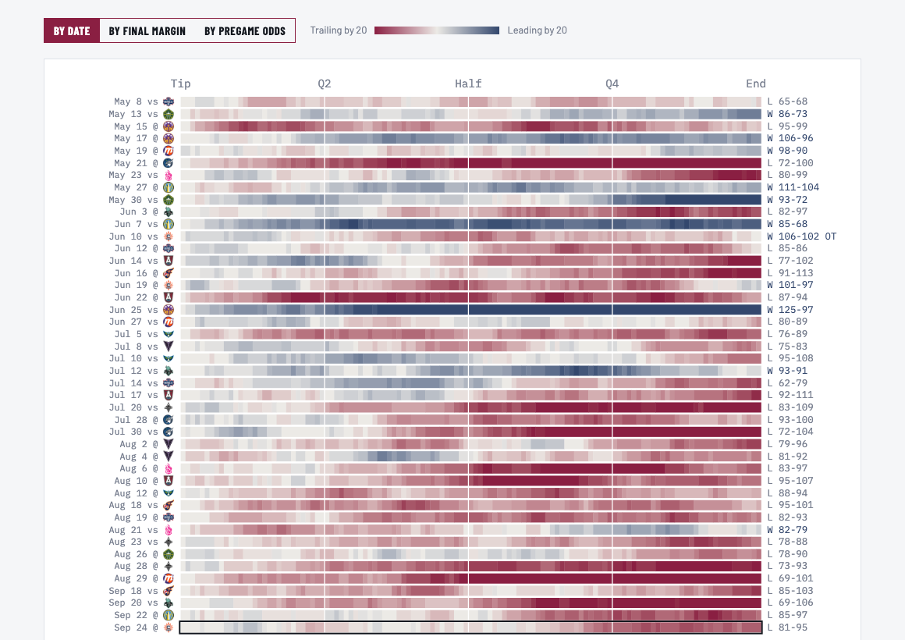
<sub><b>The game grid.</b> Every minute of every game: navy when Toronto led and bordeaux when it trailed. Sort by date, final margin or pregame odds, and click a row to see that game's margin chart.</sub>

<table>
<tr>
<td width="50%">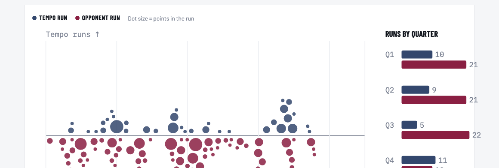<br><sub><b>The 8–0 problem.</b> Opponents had 74 runs of 8+ unanswered points. Toronto had 35.</sub></td>
<td width="50%">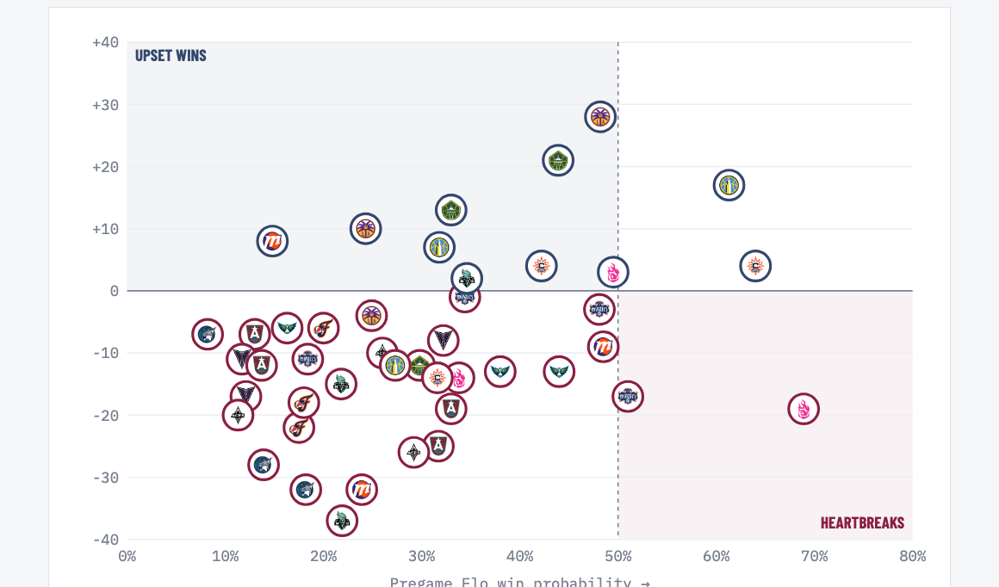<br><sub><b>Upsets and heartbreaks.</b> Pregame Elo odds vs final margin, with each game marked by the opponent's logo. Elo expected 13.4 wins, and Toronto got 11.</sub></td>
</tr>
</table>

## 05 · [Game Center](https://jordanngo205.github.io/toronto-tempo-analytics/game-center/)

> Pick a game. Get the full recap.

<div align="center">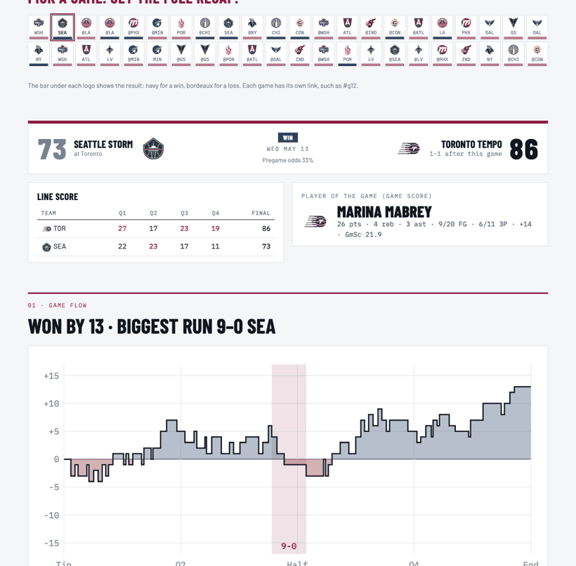</div>

Each of the 44 games has a scoreboard, line score, player of the game, game flow with scoring runs marked, both teams' shot charts (with first-half and second-half filters), key battles and full box scores. Each game has its own link, for example [`#g12`](https://jordanngo205.github.io/toronto-tempo-analytics/game-center/#g12).

---

## How it's built

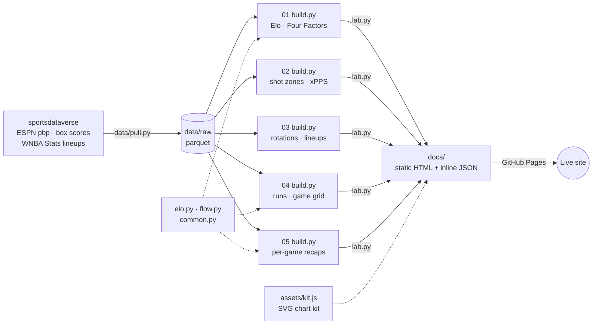

- **No chart libraries.** Every chart is SVG drawn by a small shared kit ([`docs/assets/kit.js`](docs/assets/kit.js)) that covers scales, hex courts, tooltips and label placement.
- **Data inside each page.** Each build script writes its data as JSON inside the page, so the site needs no server and the pages also work when opened from a local folder.
- **Official team colours and logos.** The palette is Tempo bordeaux and navy, Valkyries violet and Fire pink. It was checked for colour-blind separation, with lighter versions for dark mode.
- **Light and dark themes**, and layouts that work on phones.

## Methods

| Metric | How it's calculated |
|---|---|
| **Elo** | Every WNBA game since 2003: K = 20, 80-point home edge, margin-of-victory multiplier, 25% regression to 1500 between seasons, new franchises start at 1300 ([`elo.py`](elo.py)) |
| **Possessions** | FGA − ORB + TOV + 0.44·FTA |
| **Expected pts/shot** | League points per shot in the zone of each attempt: rim, short paint, three midrange zones, corner 3s and three above-the-break zones |
| **Shot making** | Actual points per shot minus expected |
| **Usage** | (FGA + 0.44·FTA + TOV) ÷ team plays while the player was on the court |
| **Runs** | Consecutive points by one team with no opposing points between them, free throws included |
| **Clutch** | Within 5 points at any point in the last 5 minutes |

## Run it yourself

```bash
git clone https://github.com/jordanngo205/toronto-tempo-analytics.git
cd toronto-tempo-analytics
python3 -m venv .venv && .venv/bin/pip install -r requirements.txt
.venv/bin/python data/pull.py              # 2025–26 data + 2003–24 history → data/raw/*.parquet
.venv/bin/python build_site.py             # rebuild every page in docs/
.venv/bin/python build_site.py --shots     # also refresh screenshots (needs Google Chrome)
open docs/index.html
```

<details>
<summary><b>Repo layout</b></summary>

```
├── 01_expansion_class/   build.py · page.html       → docs/expansion-class/
├── 02_shot_diet/         build.py · page.html       → docs/shot-lab/        (+ analysis.py static charts)
├── 03_player_impact/     build.py · page.html       → docs/rotation-lab/    (+ analysis.py static charts)
├── 04_close_games/       build.py · page.html       → docs/game-flow/       (+ analysis.py static charts)
├── 05_game_recap/        build.py · page.html       → docs/game-center/     (+ recap.py PNG cards)
├── data/pull.py          sportsdataverse → data/raw/ (gitignored)
├── common.py · elo.py · flow.py · lab.py · build_site.py · home.html
├── assets/logos/         team logos
└── docs/                 the GitHub Pages site
```
</details>

<details>
<summary><b>Static chart gallery (matplotlib)</b></summary>

Each project folder also has an `analysis.py` that renders static PNGs for slides or social posts.

<table>
<tr>
<td>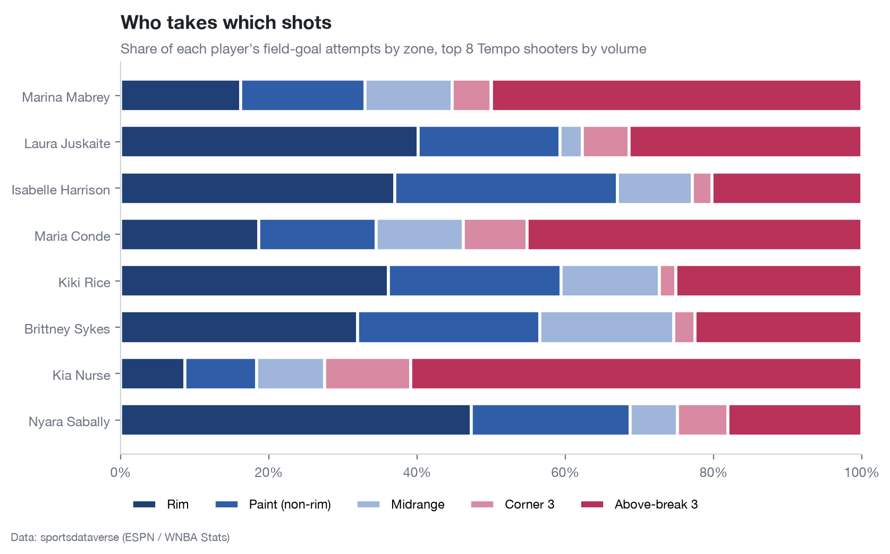</td>
<td>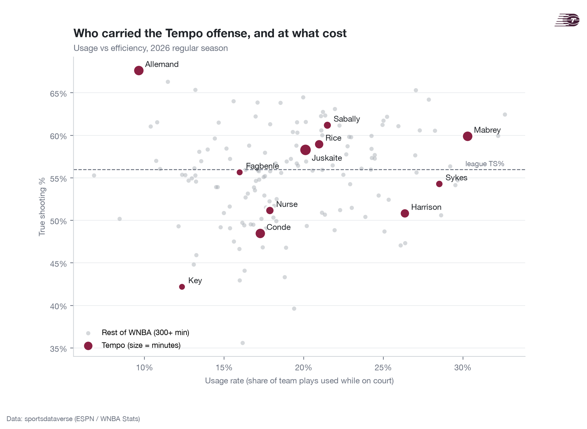</td>
</tr>
<tr>
<td>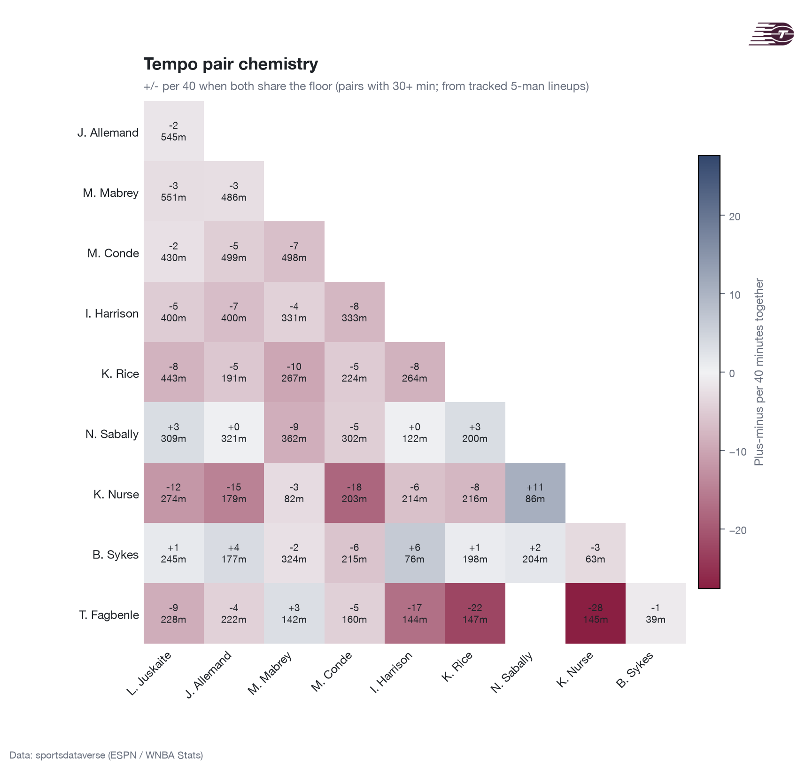</td>
<td>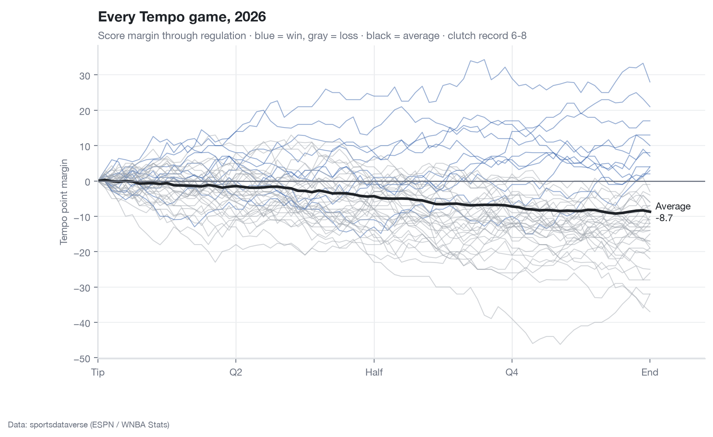</td>
</tr>
</table>
</details>

---

<div align="center">

Built by **Jordan Ngo**. Data from [sportsdataverse](https://py.sportsdataverse.org/). Inspired by [Rise of the Valkyries](https://riseofthevalkyries.substack.com/) and [Neil Paine](https://neilpaine.substack.com/t/basketball).

<sub>Unofficial fan project. Team names and logos belong to their owners.</sub>

</div>
