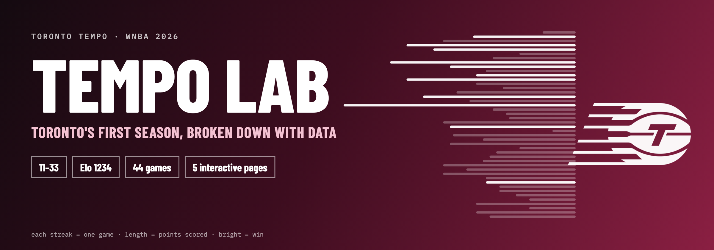
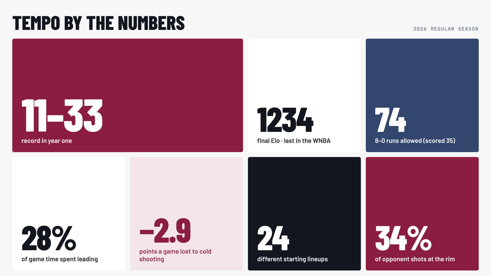
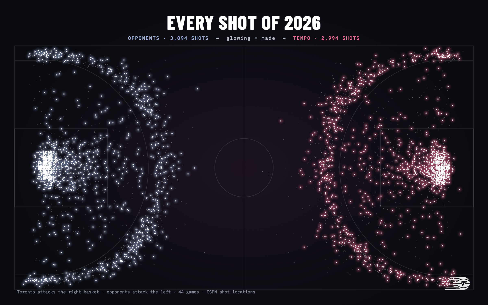
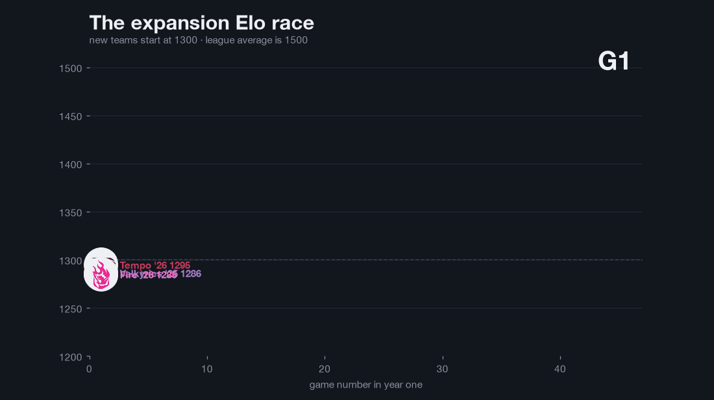
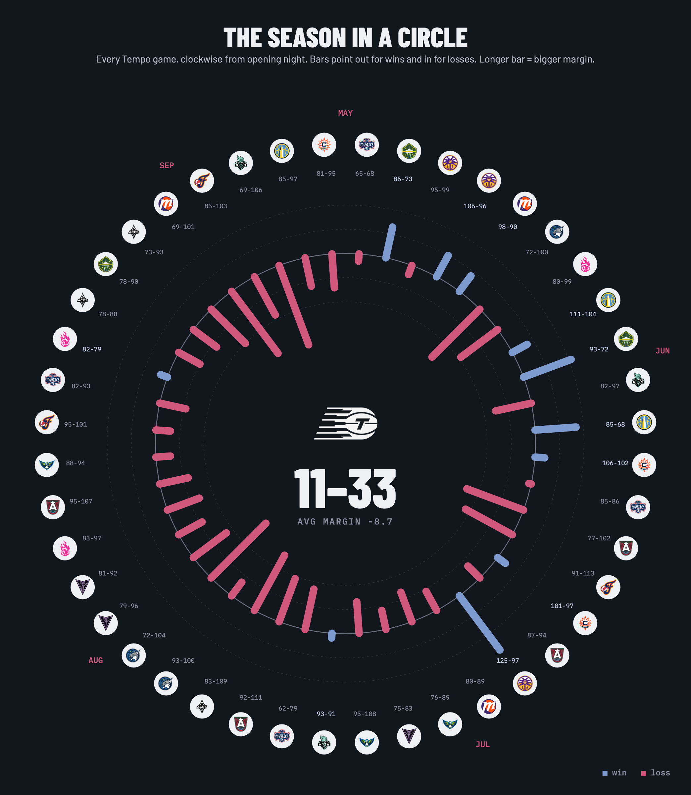
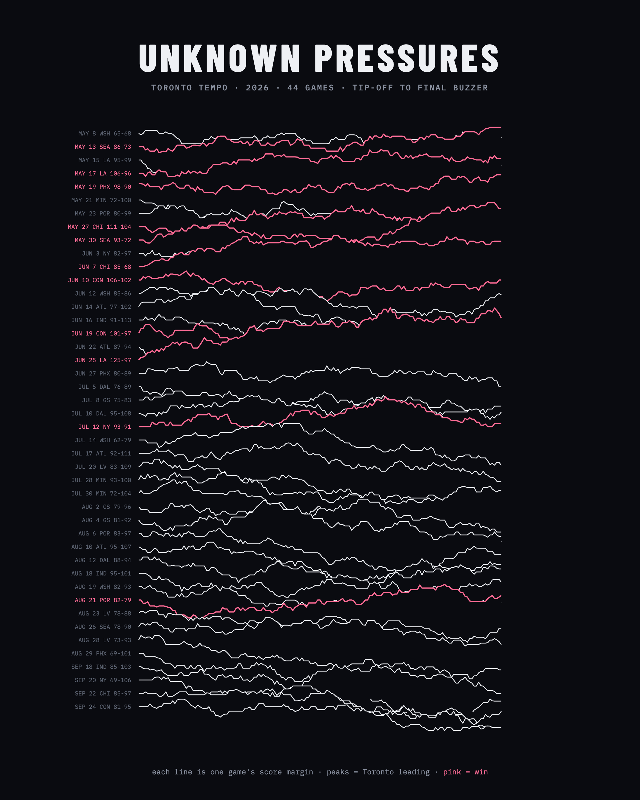
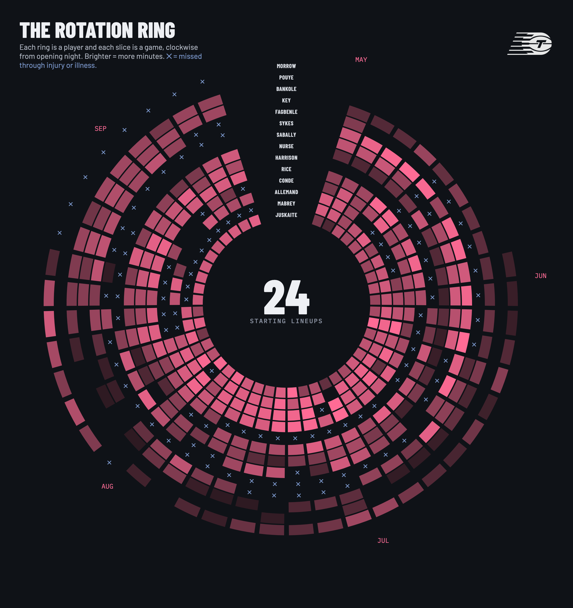
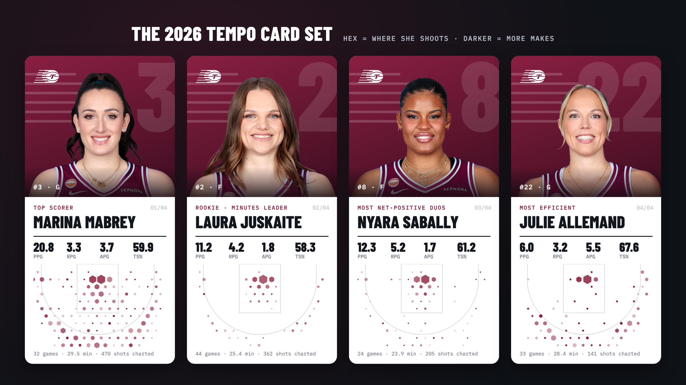
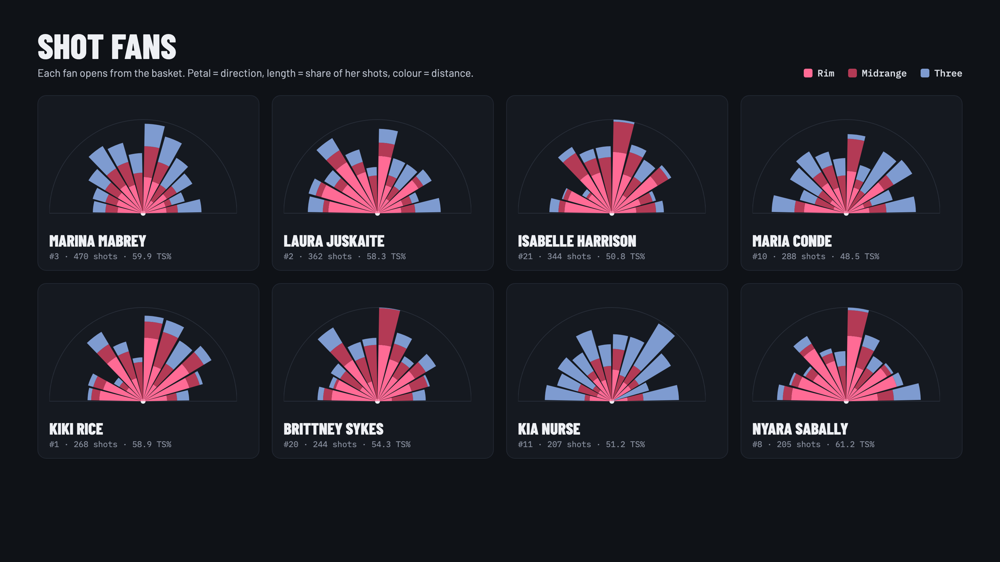
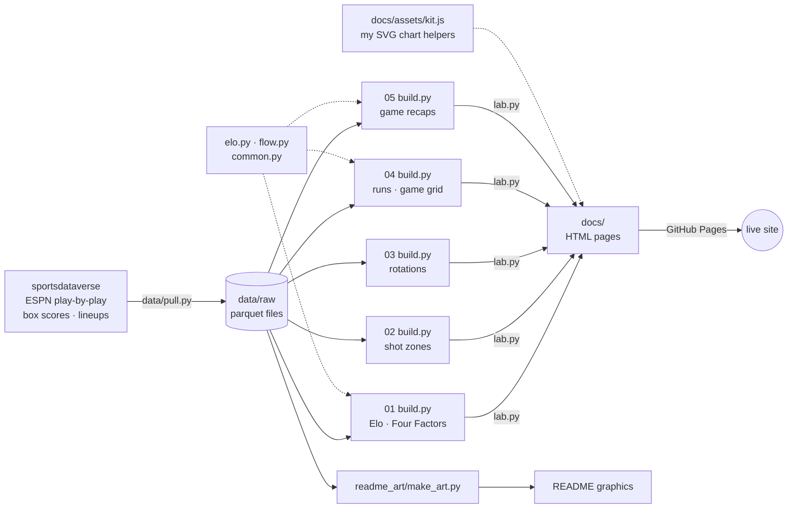

<a href="https://jordanngo205.github.io/toronto-tempo-analytics/"></a>

<div align="center">

[](https://jordanngo205.github.io/toronto-tempo-analytics/)
[](https://www.python.org/)
[](https://py.sportsdataverse.org/)
[](docs/assets/kit.js)

</div>

The Toronto Tempo joined the WNBA in 2026 and went **11–33**. This repo pulls every game, shot and lineup from that season and turns them into five interactive pages. The goal is to explain why the season went the way it did, and what year two needs.



---

## Every shot of the season



Each dot is one field-goal attempt from a Tempo game, and the glowing dots are makes. Toronto attacks the right basket and its opponents attack the left. Both ends are crowded around the rim, and the opponent end is brighter: opponents made more of their shots than Toronto did.

---

## The expansion race

The Tempo, the 2026 Portland Fire and the 2025 Golden State Valkyries all started at the same Elo rating, 1300. Golden State went 23–21 and made the playoffs in year one. Toronto finished last in the league.

<div align="center"></div>

## The season in a circle

<table>
<tr>
<td width="55%"></td>
<td width="45%">

**44 games, one picture.** Each bar is one game, and the length of the bar is the final margin.

- **9 of the 11 wins** came in May and June (top right).
- After beating New York on July 12, Toronto won only once more: **82–79 over Portland** on August 21.
- The biggest win was **125–97** over LA on June 25. The worst loss was **69–106** at home to New York on September 20.

</td>
</tr>
</table>

## Unknown Pressures

<table>
<tr>
<td width="50%"></td>
<td width="50%"></td>
</tr>
<tr>
<td><sub><b>Unknown Pressures.</b> Every game's score margin from tip-off to the final buzzer, stacked like the Joy Division album cover. Peaks mean Toronto was leading, and the 11 pink lines are wins. Most of the pink is near the top, in May and June.</sub></td>
<td><sub><b>The rotation ring.</b> Each ring is a player and each slice is a game. Laura Juskaite, the innermost ring, played all 44 games. Brittney Sykes played only 17, and the ✕ marks show how much of the roster spent the season injured.</sub></td>
</tr>
</table>

## The card set



Each card's mini shot chart comes from that player's own 2026 shots: hex size shows where she shoots, and darker means more makes.



**Shot fans** open from the basket. Each petal is a direction, its length is the share of a player's shots taken that way, and the colour shows the distance. Kia Nurse's fan is mostly blue, because 72% of her shots were threes. Nyara Sabally took nearly half of her shots at the rim.

---

## What's on the site

| | Page | What you can do there |
|:---:|---|---|
| **01** | [**The Expansion Class**](https://jordanngo205.github.io/toronto-tempo-analytics/expansion-class/) | Compare the Tempo, Fire and Valkyries with Elo, the Four Factors, hex shot maps and roster experience. The 2006 Sky and 2008 Dream are included as history. |
| **02** | [**Shot Lab**](https://jordanngo205.github.io/toronto-tempo-analytics/shot-lab/) | Pick any Tempo shooter and see every make and miss. Compare expected vs actual points per shot for every player in the league. |
| **03** | [**Rotation Lab**](https://jordanngo205.github.io/toronto-tempo-analytics/rotation-lab/) | See who played in every game, a network of which pairs worked together, and lineup results. |
| **04** | [**Game Flow**](https://jordanngo205.github.io/toronto-tempo-analytics/game-flow/) | See every minute of every game, every 8–0 run, and upsets measured against pregame odds. |
| **05** | [**Game Center**](https://jordanngo205.github.io/toronto-tempo-analytics/game-center/) | Pick any of the 44 games for a full recap: game flow, shot charts and box scores. |

---

## How it's built



- **Python** pulls the data, does all the math, and saves the results as JSON inside each page.
- **JavaScript** draws every chart as SVG by hand, without a chart library. The shared helpers are in [`docs/assets/kit.js`](docs/assets/kit.js).
- **The README graphics** are built from the same data by [`readme_art/make_art.py`](readme_art/make_art.py): the banner, by-the-numbers poster, Elo race GIF, shot constellation, season ring, Unknown Pressures ridgeline, rotation ring, card set and shot fans. Each one is a small HTML poster screenshotted with headless Chrome, except the GIF, which matplotlib renders.
- Everything uses the official team colours: Tempo bordeaux and navy, Valkyries violet and Fire pink.

## Methods

| Metric | How it's calculated |
|---|---|
| **Elo** | Every WNBA game since 2003: K = 20, 80-point home edge, margin-of-victory multiplier, 25% regression to 1500 between seasons, new teams start at 1300 ([`elo.py`](elo.py)) |
| **Possessions** | FGA − ORB + TOV + 0.44 × FTA |
| **Expected pts/shot** | League points per shot for the zone each shot came from |
| **Shot making** | Actual points per shot minus expected |
| **Usage** | (FGA + 0.44 × FTA + TOV) ÷ team plays while the player was on the court |
| **Runs** | Points in a row by one team with no opposing points between them |

## Run it yourself

```bash
git clone https://github.com/jordanngo205/toronto-tempo-analytics.git
cd toronto-tempo-analytics
python3 -m venv .venv && .venv/bin/pip install -r requirements.txt
.venv/bin/python data/pull.py              # download 2025–26 data + 2003–24 history
.venv/bin/python build_site.py             # rebuild every page in docs/
.venv/bin/python readme_art/make_art.py    # rebuild the README graphics (needs Google Chrome)
open docs/index.html
```

<details>
<summary><b>Repo layout</b></summary>

```
├── 01_expansion_class/   build.py · page.html  → docs/expansion-class/
├── 02_shot_diet/         build.py · page.html  → docs/shot-lab/      (+ analysis.py: static PNG charts)
├── 03_player_impact/     build.py · page.html  → docs/rotation-lab/  (+ analysis.py)
├── 04_close_games/       build.py · page.html  → docs/game-flow/     (+ analysis.py)
├── 05_game_recap/        build.py · page.html  → docs/game-center/   (+ recap.py: PNG recap cards)
├── readme_art/           make_art.py → out/ (the graphics in this README)
├── data/pull.py          sportsdataverse → data/raw/ (not committed)
├── common.py · elo.py · flow.py · lab.py · build_site.py · home.html
├── assets/               team logos and player headshots
└── docs/                 the GitHub Pages site
```
</details>

---

<div align="center">

Built by **Jordan Ngo** · data from [sportsdataverse](https://py.sportsdataverse.org/) · inspired by [Rise of the Valkyries](https://riseofthevalkyries.substack.com/) and [Neil Paine](https://neilpaine.substack.com/t/basketball)

<sub>Unofficial fan project. Team names, logos and player photos belong to their owners.</sub>

</div>
